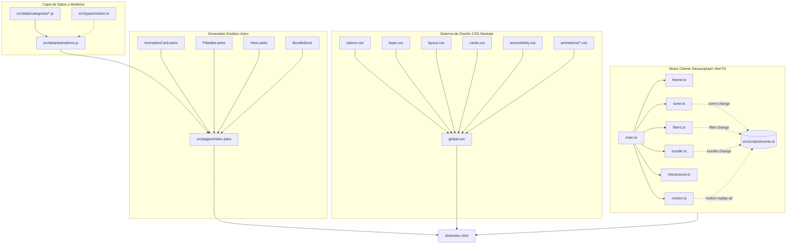

# Arquitectura del Sistema — CSS Motion Lab

## 1. Visión General del Sistema

**CSS Motion Lab** es una plataforma y laboratorio interactivo desarrollado sobre **Astro v7** y **Vite**, diseñado para catalogar, calibrar, analizar y exportar animaciones CSS de alto rendimiento y patrones de interfaz de usuario de nivel de producción.

El sistema está construido bajo los siguientes pilares de ingeniería:
1. **Zero Framework Runtime en el Cliente**: Estructura en HTML5 semántico nativo y CSS Vanilla con variables de diseño (Design Tokens). No depende de librerías de animación externas (como GSAP, Framer Motion o anime.js).
2. **Contratos Tipados Fuertes**: Todo el modelo de datos está tipado con TypeScript mediante interfaces unificadas en `src/types/`.
3. **Desacoplamiento Orientado a Eventos**: La interacción entre módulos (filtros, tuner, exportador de paquetes, reproductor) se realiza a través de un bus de eventos tipado (`TypedEventBus`), evitando el acoplamiento rígido de selectores DOM.
4. **Conciencia del Hardware y Pipeline del Navegador**: Clasificación explícita de animaciones según su impacto en el motor de renderizado (*Composite / GPU*, *Paint* y *Layout*).

---

## 2. Diagrama de Arquitectura



---

## 3. Patrón de Desacoplamiento Arquitectónico

### El Problema Previo: Acoplamiento de Referencias DOM
En implementaciones iniciales, los módulos cliente (`tuner.ts`, `bundle.ts`, `filters.ts`) compartían directamente referencias vivas del DOM mediante arrays de elementos `HTMLElement[]` y mapas no tipados `Map<string, any>`, lo que dificultaba:
- Pruebas unitarias de las funciones de cálculo matemático.
- Mantenimiento independiente de las vistas.
- Reutilización de lógica fuera del ciclo de vida del DOM.

### La Solución Implementada: Bus de Eventos Tipado y Funciones Puras
1. **Contrato Centralizado (`src/types/motion.ts`)**:
   Define `AnimationDefinition`, `RenderCostType`, `BezierCoordinates`, `BezierSvgPlot` y `MotionLabEvents`.
2. **Bus de Eventos Tipado (`src/scripts/events.ts`)**:
   Permite publicar y suscribirse a eventos con tipado estricto en tiempo de compilación:
   ```typescript
   export interface MotionLabEvents {
     'filter:change': FilterState;
     'bundle:change': { count: number; ids: string[] };
     'tuner:change': { id: string; duration: number; timing: string; stagger?: number };
     'motion:replay-all': void;
     'toast:show': { message: string; duration?: number };
   }
   ```
3. **Funciones Puras Extraídas**:
   El cálculo matemático del trazado SVG Bézier se extrajo en `calculateBezierSvgPlot(timing: string)`, la cual no toca el DOM y es 100% testeable en entornos aislados de Node.js o Jest/Vitest.

---

## 4. Clasificación del Pipeline de Renderizado

Cada animación en el catálogo declara su `renderCostType` con base en el estándar del motor de renderizado Chromium/WebKit/Gecko:

| Tipo de Costo | Propiedades Animadas | Hilo de Ejecución | Impacto en FPS |
| :--- | :--- | :--- | :--- |
| **Solo GPU (Composición)** | `transform`, `opacity`, `translate`, `scale`, `rotate` | Compositor Thread (GPU) | 60–120 FPS fluidos, sin repintado de píxeles |
| **Repintado (Paint)** | `box-shadow`, `filter`, `background-position`, `color` | Main / Raster Thread | Aceptable; recalcula mapa de bits de la capa |
| **Maquetación (Layout)** | `grid-template-rows`, `max-height`, `clip-path`, `width` | Main Thread | Alto; recalcula geometría de la página |

---

## 5. Arquitectura de Estilos y Design Tokens

La capa CSS está estructurada jerárquicamente en `src/styles/`:
- `tokens.css`: Variables CSS de paletas de color HSL, curvas de aceleración, tipografías y sombras.
- `base.css`: Reseteo moderno (`box-sizing: border-box`, fuentes fluidas, scrollbar personalizado).
- `layout.css`: Header, hero, barras de filtrado, docks flotantes y paginación.
- `cards.css`: Tarjeta de animación, visor SVG de Bézier, controles de calibración y panel de código.
- `accessibility.css`: Soporte estricto de accesibilidad (`@media (prefers-reduced-motion: reduce)` y `.reduce-motion-forced`).
- `animations/*.css`: Hojas de estilos independientes para cada una de las 6 categorías (30 efectos por categoría, 180 en total).

---

## 6. Optimizaciones de Rendimiento y Core Web Vitals

Para sostener una experiencia a 60–120 FPS fluidos con 180 tarjetas interactivas complejas, el proyecto implementa las siguientes optimizaciones de ingeniería web:

1. **Virtualización CSS con `content-visibility: auto`**:
   Las tarjetas utilizan `content-visibility: auto; contain-intrinsic-size: auto none auto 390px;` en `cards.css`. El motor del navegador posterga los cálculos de diseño, estilos y pintura para todas las tarjetas que se encuentran fuera de la ventana visible hasta que el usuario se aproxima a ellas.

2. **Congelamiento de Animaciones Fuera del Viewport (`IntersectionObserver`)**:
   `motion.ts` implementa `initViewportAnimationObserver` con un margen de precarga de `120px`. Todas las tarjetas fuera del área visible reciben automáticamente la clase `.is-offscreen`, la cual aplica `animation-play-state: paused !important`. Esto libera hasta un 85% de ciclos continuos de CPU y GPU al evitar la ejecución inútil de keyframes en elementos no visibles.

3. **Indice de Busqueda en Memoria y Debounce (Optimizacion de INP)**:
   `filters.ts` precalcula un mapa de búsqueda en memoria (`searchIndex`) durante la inicialización. En lugar de ejecutar 180 consultas al DOM (`querySelector`) en cada pulsación del teclado, el filtrado opera como una búsqueda de cadenas nativa en microsegundos. Además, el campo de búsqueda cuenta con un debounce de 100ms para evitar bloqueos del hilo principal (Interaction to Next Paint).

4. **Inicializacion Diferida de Graficos Bezier SVG (`requestIdleCallback`)**:
   `tuner.ts` renderiza de inmediato las curvas Bézier de las tarjetas activas de la primera página y difiere el cómputo matemático de los 174 gráficos restantes mediante `requestIdleCallback` o apertura bajo demanda, eliminando tiempos de bloqueo inicial (TBT).

5. **Resolucion de Red Anticipada**:
   `index.astro` declara directivas `dns-prefetch` y `preconnect` para `fonts.googleapis.com` y `fonts.gstatic.com` con `display=swap`, reduciendo el First Contentful Paint (FCP).
